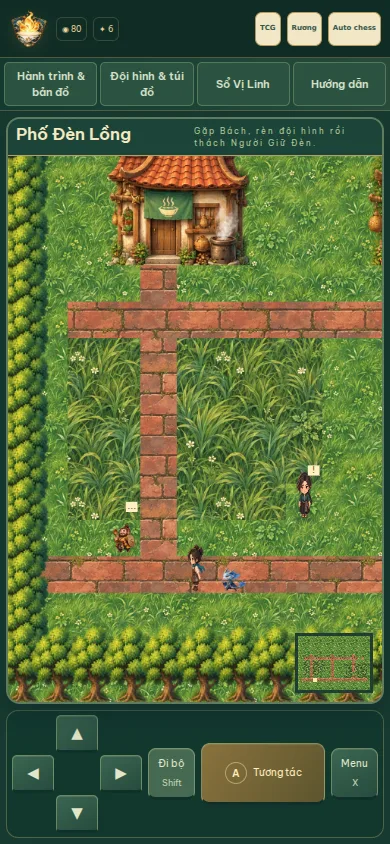
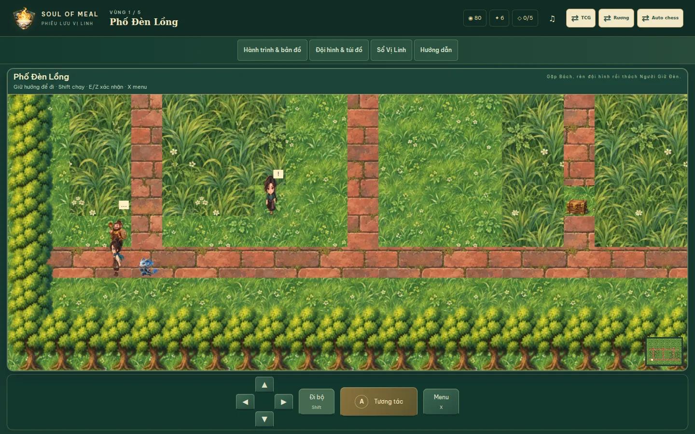
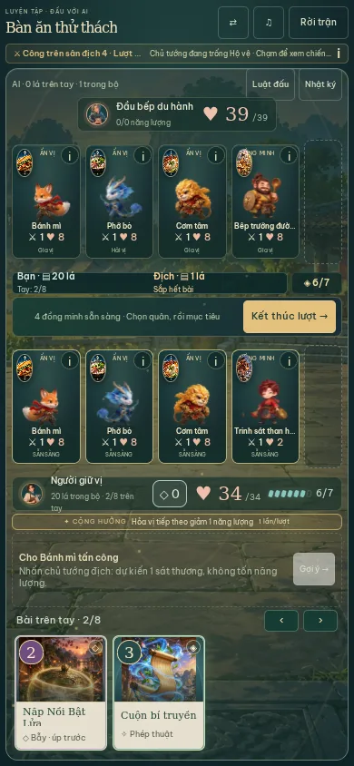

# Soul of Meal Web 4.8 · Bẫy gọn, đọc rõ và art Adventure

Ô bẫy trên bàn chỉ còn khung và hình bài khi đã úp. Bỏ tên/“Ô BẪY”/“1 chỗ”/“Sẵn sàng”/“Chờ lượt kế” trong khung; vẫn giữ ARIA mô tả và chạm để xem điều kiện. Không lộ danh tính bẫy địch khi úp.

Úp bẫy có animation đặt/lật thẻ, vòng niêm phong và ánh quét khoảng 620 ms, từ sự kiện set-trap thật. Thêm âm giấy và chime riêng bằng Web Audio, một cue mỗi sự kiện; không thêm audio file hoặc thư viện. Mute/volume hiện có giữ tác dụng; reduced motion/quiet tắt chuyển động. Bẫy kích hoạt giữ phần tên/hiệu ứng **2.250 ms**, tăng đúng một giây từ 1.250 ms. Mô tả bỏ giới hạn ba dòng để đọc đầy đủ. Chi phí, điều kiện, phản ứng, 1 ô bẫy và hiệu ứng gameplay giữ nguyên. Nút Bỏ qua/Hủy chọn/Kết thúc lượt có identity riêng, tránh tái dùng cùng DOM button khi animation vừa kết thúc.

## Đồng bộ bộ bài và nhánh phát hành

Bộ mới **24 lá**, tối đa hai bản/thẻ, bốn đồng minh và một ô bẫy riêng. Xưởng, store và constructor trận/hành trình dùng cùng giới hạn theo phiên bản. Constructor từ chối thiếu/dư lá, bản thứ ba hoặc thẻ mới hơn luật trước khi chia bài. Luyện đấu, chiến dịch, bạn bên bếp, tuần và run mới đều dùng 24; bạn bên bếp báo rõ lỗi deck thay vì trả false im lặng. Hướng dẫn trong trận hiển thị 18 hoặc 24 theo luật đang chơi.

Save/key/version gốc giữ nguyên. Bộ cũ và trận/run đang lưu không tự bị viết lại; luật 350/400/450 tiếp tục 18 lá và ba ô, luật 470 dùng 24/bốn ô. Các trận kế tiếp trong run cũ vẫn gọi constructor với phiên bản đã lưu. Không reset tiền/XP/bụi/vé, lịch sử, Auto/Adventure, không sửa/sync/build native. Luồng bổ sung 24 lá và gói sáu lá 4.7 vẫn có sẵn.

Khi bắt đầu kiểm tra, master ở **e10e9b9 / 4.5.0**: PR #36 đã merge vào nhánh 4.5, PR #37 merge vào nhánh 4.6, nên các bản đó chưa đi vào master. Bản này dựa trên source 4.7 đã merge (09b4c27) và tạo PR **hướng master**, gồm cả renderer/điều khiển 4.6 và luật 4.7. Không tự merge. Các ghi chú “chưa merge” trong docs bản cũ là trạng thái lịch sử lúc phát hành từng PR.

## Art Adventure trong phần 5 MB mới

Hai atlas original được tạo bằng **built-in image_gen** rồi encode WebP lossless, không đổi kích thước hoặc vẽ lại bằng script. PNG sinh thực tế 1254×1254; metadata dùng kích thước thật. So sánh ảnh giải mã xác nhận toàn bộ màu pixel có alpha > 0 và toàn bộ alpha trùng PNG gốc. [Prompt đầy đủ](prompts.json), [nguồn/hash/byte](artwork.json).

| Asset | Nội dung | Byte |
|---|---|---:|
| public/assets/adventure/world-props-v480.webp | 16 cây/nhà/vật trang trí, alpha trong suốt | 1.830.856 |
| public/assets/adventure/terrain-v480.webp | 16 nền cỏ/đường/nước/đá/sàn | 2.330.964 |
| Tổng media mới | WebP lossless | **4.161.820** |

Canvas hiện có dùng texture cho toàn bộ 20 map, cây theo vùng, ba nhà, bảng chỉ dẫn, hòm, bàn/quầy và đồ nội thất trên các ô cũ. Nền/đồ vật raster vào cache, xếp lớp theo chân; không thêm grid DOM hoặc React state theo frame. Hai atlas tải khi vào Adventure, dùng lease/cache chung và được release khi rời map. Chỉ đổi hình: tọa độ, đường đi/collision, cửa, NPC, vật phẩm và nhiệm vụ giữ nguyên. Có SVG/nền màu dự phòng khi atlas chưa tải hoặc tải lỗi. Lớp cache được kiểm tra dưới 16 MiB; con số này không bao gồm hai ảnh atlas giải mã, tổng khoảng 12 MiB.

## Kiểm chứng

**456 kiểm thử / 44 file** đạt; thêm sáu kiểm tra giới hạn constructor, các đường vào trận, thông báo deck lỗi, ô bẫy không có chữ/cue riêng/thời gian 2.25 giây, bounds atlas 1254 không chia hết cho bốn và ánh xạ tile không đổi map. Các fixture 4.0/4.5 gọi rõ phiên bản cũ để không vô tình tạo trận 18 lá dưới luật mới. Giữ số seed và ngưỡng thắng cũ. Typecheck app/dev, catalog 123 món, 148 asset refs/0 thiếu, registry 352, release verify, build/size và cú pháp service worker đạt. Sau đổi identity nút, 11 kiểm tra view/giới thiệu liên quan chạy lại đạt.

[TCG browser QA](browser-qa.json), [script](../../tools/verify-web480.mjs): 1440×900, 390×844, 844×390, 320×568; nâng deck/lưu/reload, quân thứ tư, ô bẫy không chữ, animation/cue set một lần, phản ứng trước đòn thứ tư qua reload, thời gian DOM reveal đo bằng MutationObserver, phép rút hụt/damage thật, luật 450 vẫn ba ô, viewport fit và không JS error/asset thiếu. Bỏ qua là thao tác trình bày, không đổi lượt; đo reveal trước khi bỏ qua các pha còn lại. Đo DOM độc lập với độ trễ giao tiếp của Playwright; các mẫu đo **2.272–2.309 ms**. Nút Bỏ qua được kiểm tra đã unmount trước khi xuất hiện nút Kết thúc lượt.

[Adventure browser QA](adventure-qa.json), [script](../../tools/verify-adventure480.mjs): bốn kích thước trên; held keyboard/D-pad/run, menu và trận dừng nền, thoại qua reload, clinic chữa/ra cửa, ba click chỉ một lượt, HP theo pha và arena không remount. 390 thêm tất cả 20 map/atlas/cache <16 MiB, shop/mua/vật phẩm/thu phục/tủ và demo giữ save. Không lỗi JS hoặc asset thiếu trong mẫu. Chromium headless với SwiftShader, chưa kiểm tra Safari/thiết bị thật; không quy các số này thành FPS hoặc bảo đảm độ mượt trên máy người dùng.

## Dung lượng

Build **78.440.998 byte**, tăng **4.166.082 byte** so với 4.7 (74.274.916), gồm cả media và code. Phần thêm được duyệt là 5.000.000 byte, còn **833.918 byte**. 451 file; JS gzip **625.696 / 650.000 byte**, CSS gzip **96.198 byte**, không leak dev/archive/source map. Không đổi trần 100 MB chung; guard riêng 4.8 chặn toàn bộ patch vượt 5 MB. Không tự tăng ngân sách khi lỗi build.

