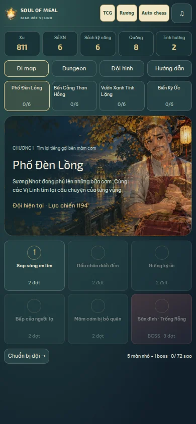
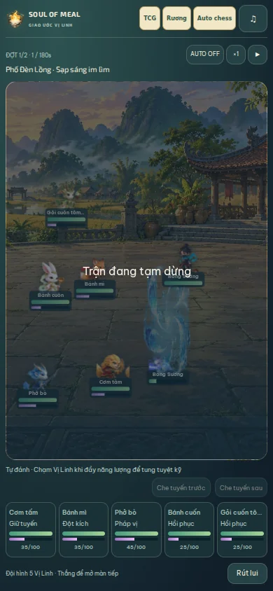
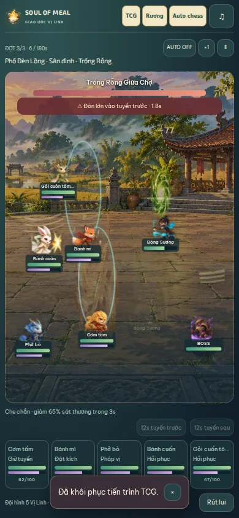

# Soul of Meal Web 5.0 — Giao ước Vị Linh

Adventure được thay bằng RPG đội hình 5 người: **đi map** để tìm lại câu chuyện và **dungeon** để farm/nuôi đội. Mỗi người có cấp, bốn kỹ năng, thăng bậc và ba ô trang bị. Dùng nhân vật, animation, đấu trường, nhạc và VFX chung TCG/Auto chess; không thêm media hoặc runtime dependency.

## Nội dung chơi được

- **4 map, 24 màn**: Phố Đèn Lồng → Bến Cảng Than Hồng → Vườn Xanh Tĩnh Lặng → Biển Ký Ức. Mỗi map có 5 màn nhỏ + 1 boss; màn thường 2 đợt, boss 3 đợt.
- Đội tối đa 5 Vị Linh; 2 ô tuyến trước, 3 ô tuyến sau. Năm vai trò: Giữ tuyến, Đột kích, Pháp vị, Hồi phục, Khống chế. Thẻ đơn vị đang sở hữu mở nhân vật đồng hành, không bị tiêu bản sao TCG.
- Đòn thường/hai kỹ năng tự động; tuyệt kỹ cần 100 năng lượng và có thể bấm bằng tay hoặc bật AUTO. Có ×2, tạm dừng và rút lui. Boss báo đòn lớn trước 2 giây, che đúng tuyến giảm 65% sát thương trong 3 giây; hồi 12 giây.
- Boss chuyển pha ở nửa HP và nhắm tuyến sau. Bốn boss lần lượt có khiên, bỏng, khống chế và rút năng lượng. Cảnh báo bị hủy khi boss bị hạ, kể cả khi quân nhỏ còn sống.
- **3 dungeon × 5 tầng × 3 bậc khó**: Kho Bếp Ấm (Sổ KN), Thư Viện Hương (Sách kỹ năng), Lò Rèn Ký Ức (Quặng/Tinh hương). Nhận thưởng từng tầng, giữ HP/năng lượng giữa tầng; tầng 2/4 chọn nghỉ hoặc +12% công. Canh Ấm/Lá Tỉnh cũ có thể dùng giữa tầng.
- Cấp nhân vật tối đa 50; Sổ KN cho 180 KN. Kỹ năng thứ hai mở cấp 5, nội tại ở bậc 2; kỹ năng tối đa 10 và không vượt cấp nhân vật. Ba ô trang bị +10; thăng bậc tối đa 5.
- Mỗi màn có thoại trước/sau và cầu nối tới vùng tiếp. Sau boss có đoạn kết và hai lựa chọn lưu trong câu chuyện. Hệ sao 1–3 giúp nhìn tiến độ, không bắt buộc farm đủ sao để mở màn.
- Chọn map, chiến đấu và các nút chính nằm trong viewport dọc/ngang. Đội hình/chi tiết và nội dung dài dùng vùng cuộn riêng. Giới thiệu 25 giây dùng cùng sân đấu/engine mới, không ghi save hoặc trao thưởng thật.

[Thiết kế, luật kinh tế và nguồn nghiên cứu chính thức](DESIGN.md).

## Bảo toàn dữ liệu

Giữ key và version gốc của `GameSave`; bổ sung `adventureRpg.version = 1`, không đổi luật TCG. Dữ liệu Adventure v1/v2 vẫn được đọc và giữ nguyên trong trường cũ, gồm đội/tủ, cấp/KN, xu, vật phẩm, huy hiệu, nhiệm vụ, vị trí và chạm trán đang lưu. Seed RPG một lần từ cấp/KN/uid, tài nguyên và huy hiệu này. Huy hiệu giữ chiến thắng vùng và mở đường tương ứng; không trả thưởng lần đầu cho những màn đã được ghi thắng.

Xu/nguyên liệu RPG tách khỏi kinh tế TCG. Trận PvP 4.9, bộ sưu tập, deck, XP/xu/tinh chất/vé, lịch sử và Auto chess giữ nguyên. Chơi lại dungeon hay mở demo không gây reset dữ liệu. Bản sao JSON/MGC1/ZIP hiện có chứa cả trường RPG mới.

Trận lưu tick, HP/năng lượng, event, hiệu ứng, cảnh báo, pause/tốc độ và dấu nhận thưởng. Reload tiếp tục đúng trạng thái; nhận thưởng gọi lại được an toàn. Mô phỏng 4 Hz; checkpoint một lần/giây, lệnh/kết quả/pagehide/đổi tab/rời trang flush ngay. Không chạy bù cả khoảng thời gian ở tab nền. Nếu trình duyệt bị kết thúc cưỡng bức trước checkpoint, có thể mất một phần rất nhỏ của giây đang mô phỏng.

## Dọn phần không dùng

Renderer đi ô, UI 1v1, walking atlas, SVG world và hai atlas 4.8 được chuyển khỏi `src`/`public` vào `dev/archive/legacy-adventure-v490`. Tổng **5.918.813 byte media** không còn nằm trong web build. Giữ bản gốc trong repo để khôi phục; kiểm tra/migrate save cũ vẫn có map identifier và metadata cần thiết. Các script QA 4.x là chứng cứ lịch sử, dùng checkout bản tương ứng để chạy lại.

Không tăng trần 100 MB hoặc JS gzip 650.000 byte. Không sửa, build hoặc sync Android/iOS. Khi bắt đầu, đã kiểm tra đúng kết nối `hoangmingzzz123-source`: PR #39/#40 đều đã merge; master là `02686077ff968ad5a6f91302f455f7666cf98632`. Nhánh 5.0 dựa trên master đó. Không tự merge cập nhật này.

## Kiểm chứng

**497 tests / 45 files** qua. App/dev typecheck, catalog (123 món), assets (141 refs/0 thiếu), registry (345 asset), notices/policy generation, production build, service-worker syntax, diff checks và size guard đều qua.

27 kiểm thử RPG mới gồm: import đội/tủ/cấp/KN cũ; kinh tế không tiêu account/TCG; khóa đội/màn; level/skill/gear/rank; manual burst; pause/reload deterministic; một lần nhận thưởng; bốn boss cảnh báo/chuyển pha/phản kích; che chắn; hủy cảnh báo boss chết; cả ba dungeon hoàn thành 5 tầng với HP/energy carry và camp; rút lui/thua giữ loot đã nhận; vật phẩm; lựa chọn truyện; malformed save bị từ chối. Một tài khoản mới vượt đủ **24 màn bằng kinh nghiệm và tài nguyên tự kiếm**, không cấp thêm tài nguyên trong bài kiểm tra vòng chơi.

[Browser evidence](browser-qa.json), [reproduction script](../../tools/verify-adventure500.mjs): Chromium/SwiftShader tại **1440×900, 390×844, 844×390, 320×568**. Nhập save cũ, màn khóa/mở, Escape thoại, tick thời gian thực, pause + reload, nhận thưởng + reload không nhân đôi, train qua nút, demo dùng view thật/ẩn chú thích/giữ save, dungeon nhận thưởng/carry/camp + reload, nút trong viewport, đối chiếu field account và legacy không đổi. Mobile 390 bổ sung boss thật qua UI: cảnh báo → che đúng tuyến → bấm tuyệt kỹ → arena không remount → thắng → thoại kết → lưu lựa chọn → map tiếp mở. Fixture này chuẩn bị đội cấp 8 và mở boss để kiểm tra tương tác, không giả định người chơi đã tự hoàn thành các màn trong browser QA.

Không có JS error hoặc missing asset trong các luồng này. Test quan sát tick thời gian thực rồi tăng tốc bằng lệnh engine ở phần farm/kết quả; không dùng con số đó làm FPS benchmark. Chưa thử Safari hoặc thiết bị thật. Giới hạn WebRTC/STUN/TURN của 4.9 giữ nguyên.

## Dung lượng

Production: **72.566.051 byte**, JS gzip **642.094 / 650.000**, CSS gzip **95.491**; 450 file, 0 dev/archive/source-map leak. Giảm **5.936.378 byte** so với 4.9. [Chi tiết ngân sách](BUDGET.md).

