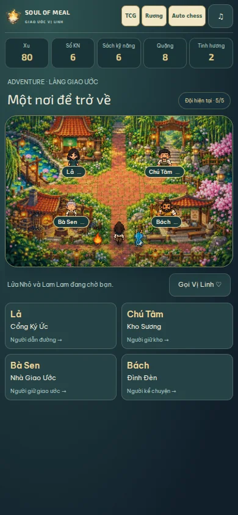
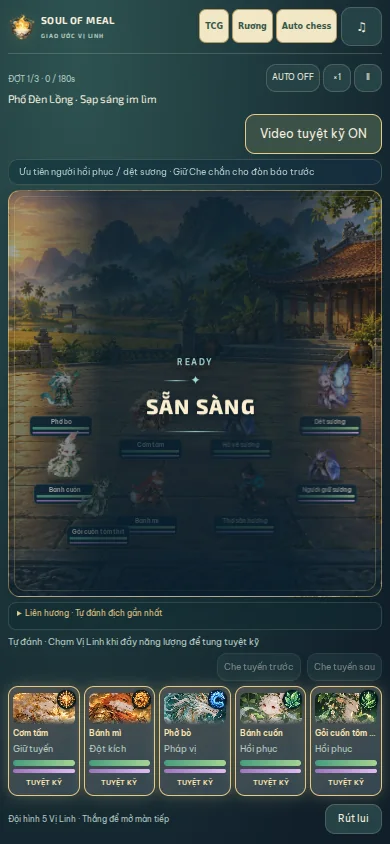
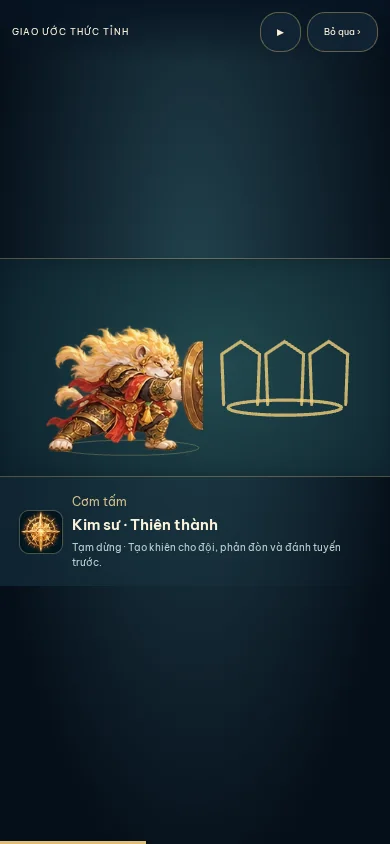
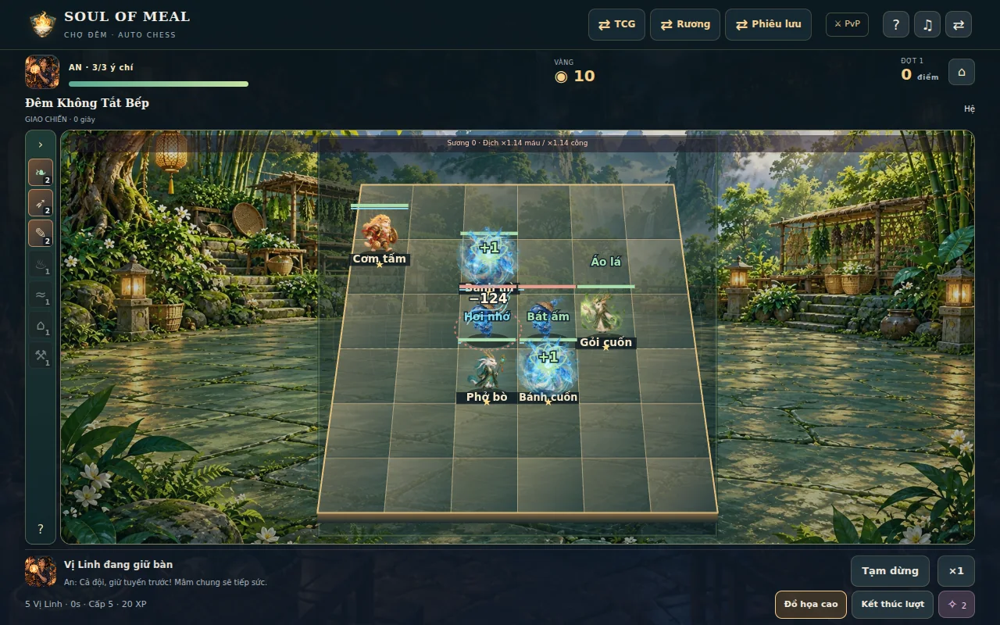
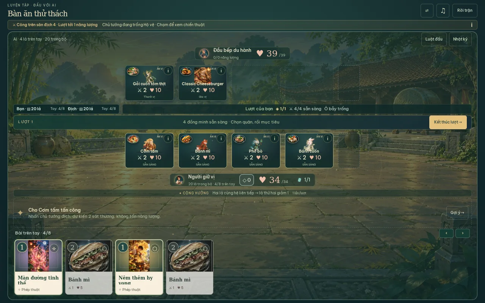

# Kiểm chứng Web 5.9 · 16/10/2026

Luồng được kiểm: làng/chạm NPC → React UI → reducer đã có → local save/schema → trận thật → trình bày kết quả. Game chạy phía trình duyệt, không có API/database trong luồng này. Bản production được kiểm thêm bằng snapshot QA đã lưu, không thêm đường debug vào sản phẩm.

## Kết quả

- Typecheck ứng dụng và dev đạt. **650/650 test, 57 file** đạt; thêm kiểm tra đúng 5 starter, ID/alias giữa các chế độ, frame/pivot, contact theo tốc đánh, ranh giới pha, reload/skip không gây damage hoặc nhận thưởng lần hai. Giữ các kiểm tra cũ về engine, độ khó, rương, PvP, save và tiến trình.
- Catalog: 123 món, 35 tag, 9 event hợp lệ. Asset validator: 161 tham chiếu tĩnh, không thiếu. Release records: 603 asset được ghi nhận, 32 dependency runtime, 3 policy tĩnh; không thêm dependency runtime.
- 11 atlas mới: 5 chi tiết + 5 pixel + 1 làng; **404 ô không rỗng**, gồm 160 pose chi tiết, 160 biến thể pixel và 84 frame làng. Mỗi atlas có đúng số frame riêng biệt mong đợi; ảnh có alpha, khung nguồn hợp lệ. 5 âm thanh đã được giải mã bằng ffmpeg, đều MP3 mono 24 kHz, khoảng 2,4 giây; giữ nhạc và âm thanh những nhân vật khác.
- Chromium headless tại **320×568, 390×844, 844×390, 1440×900**: 7 nhân vật pixel ở làng, không méo tỷ lệ, đi tới NPC mở hội thoại; 5 starter trong trận; các nút tuyệt kỹ nằm trong viewport, không tràn ngang.
- Ready/Start/Next Wave/Win/Fail hiển thị bằng chữ, không có atlas trạng thái cũ. Kiểm tra typography ở màn nhỏ phát hiện CSS cũ đè font và đã sửa; ảnh cuối xác nhận “SẴN SÀNG” trên một dòng.
- Cả 5 tuyệt kỹ đi đủ Preparation/Casting/Impact/Finisher/Recovery. Mỗi cảnh chỉ có một canvas nhân vật hoặc một video/fallback; không phủ portrait, canvas và video cùng lúc. Pause giữ tiến trình, skip đóng một lần. Reload một cast đã ghi nhận rồi skip không đổi actor/resources của cast đã lưu.
- Auto Chess solo thực sự vào combat với 5 model starter, dùng cùng board/pose resolver với PvP. TCG thật có đủ 5 danh tính starter trên hai phía và một thẻ khác dùng artwork riêng; tấn công không tạo thêm bản sao model bay. Đây không phải một lần kiểm PvP bằng hai thiết bị mới.
- Production build hydrate được trận QA, tải atlas đúng, tung/tạm dừng/bỏ qua tuyệt kỹ thành công ở 390×844. Không lỗi JavaScript hoặc asset 4xx trong lượt kiểm.

## Hiệu năng và dung lượng

Vòng đầu khi cast 5 chiêu cùng lúc có rAF khoảng 22,3 FPS so với 38,2 FPS trước cast. Không chấp nhận số đo đó làm kết quả cuối. Đã giới hạn vẽ lại pixel/VFX ở khoảng 30 Hz, bỏ các phép repaint gradient/radius liên tục của khiên và bỏ chuyển động thân CSS trùng với atlas.

Lượt đầy đủ cuối: rAF **54,7 FPS** khi 5 chiêu liên tiếp, trước cast **41,0 FPS**, p95 khoảng cách frame **33,3 ms**. Tối đa **5 cue**, sau 3,2 giây còn **0**, battle serial 46 xác nhận các action thật đã chạy. rAF là số đo nhịp trình duyệt trong mẫu headless dùng SwiftShader; sprite pixel được giới hạn 30 Hz. Không suy ra “mọi điện thoại chạy 55/60 FPS”. Xem `browser-qa.json` và `metrics.json`.

Build tĩnh: **256.942.218 byte**, giảm **2.832.979 byte** so với master; JS gzip **673.875 byte**, CSS gzip **104.098 byte**, trong giới hạn có sẵn 260 MB/675 KB JS. Release guard và kiểm tra guard đạt; không source map, mã nguồn dev, archive hoặc mẫu credential nhận diện được trong dist. Giữ cảnh báo chunk lớn đang có; không tăng ngân sách.

## Rà trùng và giới hạn thực tế

- Audit thêm 139 portrait không có nhóm trùng hash ảnh; 40 định danh địch đang dùng có model riêng, 8 định nghĩa cũ không được sử dụng giữ để tương thích. Các lần lặp cùng enemy ID ở nhiều wave/vai trò được phân loại là có chủ đích.
- Audit 139 danh tính TCG và 44 quân Auto Chess không còn nhóm `(sheet,row)` dùng chung cho danh tính khác nhau. Model chuyên biệt cũ được giữ; **94 thẻ dùng artwork fallback riêng**. Chúng chưa có atlas đầy đủ như 5 starter, và không được gọi là “94 model mới”. Alias Gỏi cuốn là dùng chung có chủ đích giữa cùng một nhân vật.
- Bộ sprite chiến đấu là 2D với 4 key pose/trạng thái và chuyển động thân bổ sung, không phải mesh/rig 3D. Biến thể pixel chiến đấu được đóng từ atlas chi tiết; atlas làng được tạo riêng cho góc nhìn RPG. Chưa phải quy trình pixel art vẽ tay từng điểm ảnh.
- Chưa đo hoặc nghe trên iPhone/Safari, Android và GPU thật. Cần lượt nghiệm thu thiết bị thật để đánh giá cảm giác animation, âm lượng và hiệu năng dài hạn. Lượt kiểm này không tuyên bố chất lượng mỹ thuật đã được chủ dự án duyệt.
- Chưa nâng toàn bộ 134 cinematic ngoài starter lên chuẩn native timeline; chúng vẫn dùng clip hiện có, nay có compositing loại trừ fallback. Phát triển bộ animation riêng cho các thẻ tiếp theo theo `CHARACTER_STANDARD.md`, ưu tiên danh sách 94 fallback trong `model-audit.json`.

## Ảnh và lệnh tái kiểm

`dev/tools/verify-web590.mjs` dùng Playwright/Chromium ngoài dependency sản phẩm. Có thể đặt `PLAYWRIGHT_MODULE`, `CHROMIUM_BIN`, `CHROMIUM_LIB_DIR`, `CHROMIUM_ARGS` (JSON array), `FONTCONFIG_PATH`. Chạy `pnpm build` trước để bao gồm lượt production; `QUICK_PERF=1` chỉ dùng để đo nhanh trong quá trình sửa, không thay báo cáo đầy đủ.

Các kiểm tra khác: `pnpm typecheck`, `pnpm typecheck:dev`, `pnpm test`, `pnpm validate:catalog`, `pnpm validate:assets`, `pnpm release:verify`, `pnpm build`, `pnpm release:size`, `node --test dev/tests/release-guard.test.mjs`.
