# SOUL OF MEAL — ADVENTURE WORLD 2.0
## Đặc tả World Map, NPC, Nhà cửa, Hội quán & Chuyển vùng

> **Phiên bản:** v1.1 • **Ngày:** 26/10/2026  
> **Trạng thái:** Đặc tả thiết kế để triển khai, chưa xác nhận các cơ chế này đã được code.  
> **Định hướng tham khảo:** Cấu trúc khám phá bản đồ kiểu *Pokémon HeartGold / SoulSilver*, nhưng sử dụng cốt truyện, mỹ thuật, bản đồ, nhân vật và dữ liệu nguyên bản của Soul of Meal.  
> **Nhánh mục tiêu:** `game/adventure-world-2` • **Đối tượng:** BA, story-agent, mechanic-agent, animation-agent, character-agent, tester-agent, scretary-agent.

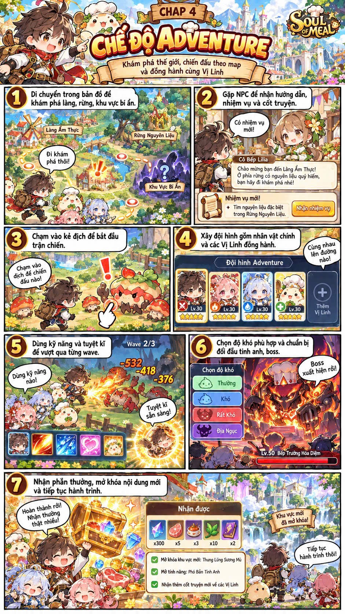

*Hình 1. Chapter 4 do chủ dự án cung cấp — tài liệu tham khảo phong cách, không phải bằng chứng rằng mọi cơ chế trong đặc tả đã hoàn thiện.*

---

## Mục lục
1. [Tầm nhìn và nguyên tắc](#1-tầm-nhìn-và-nguyên-tắc)
2. [Hệ thống World → Region → Map → Interior](#2-hệ-thống-world--region--map--interior)
3. [Di chuyển tự do, camera và va chạm](#3-di-chuyển-tự-do-camera-và-va-chạm)
4. [Vào nhà, hội quán và công trình nhiều tầng](#4-vào-nhà-hội-quán-và-công-trình-nhiều-tầng)
5. [NPC: đời sống, hội thoại, nhiệm vụ](#5-npc-đời-sống-hội-thoại-nhiệm-vụ)
6. [Vị Linh đồng hành](#6-vị-linh-đồng-hành)
7. [Chuyển vùng, mở khóa và Fast Travel](#7-chuyển-vùng-mở-khóa-và-fast-travel)
8. [Quái trên map và chuyển sang đội hình RPG](#8-quái-trên-map-và-chuyển-sang-đội-hình-rpg)
9. [Khám phá, rương và nấu ăn](#9-khám-phá-rương-và-nấu-ăn)
10. [Kiến trúc kỹ thuật & content contract](#10-kiến-trúc-kỹ-thuật--content-contract)
11. [Tích hợp TCG, Auto Chess và gacha](#11-tích-hợp-tcg-auto-chess-và-gacha)
12. [Vertical Slice và PR Roadmap](#12-vertical-slice-và-pr-roadmap)
13. [Test cases và Definition of Done](#13-test-cases-và-definition-of-done)
14. [Phân việc cho bảy agent](#14-phân-việc-cho-bảy-agent)
15. [Quest HUD và Single-Screen UI](#15-quest-hud-và-single-screen-ui)

---

## 1. Tầm nhìn và nguyên tắc

**Quy chuẩn UI mới (v1.1):** tất cả tương tác core diễn ra trong cùng viewport cố định (game shell), không có document/page scroll; nhiệm vụ/đội/túi/gacha mở thành submenu, panel hoặc dedicated game scene có nút quay lại. Trên màn hình nhỏ ưu tiên phân trang thay vì cố nhồi toàn bộ danh sách.

**Trải nghiệm đích:** người chơi đi bộ qua những con phố, bước vào nhà hoặc hội quán, nói chuyện với NPC, nhận nhiệm vụ, đi đường rừng, tìm rương và quái, sang vùng đất mới, rồi trở lại làng. Menu lớn chỉ xuất hiện khi thực sự tương tác với hoạt động có ý nghĩa.

**Giữ tinh thần khám phá của HeartGold:** map nhỏ/chuyên biệt nối nhau bằng cửa và biên map, nội thất riêng, NPC nhìn/di chuyển theo hướng, khu vực mở khóa theo cốt truyện; Vị Linh đi theo người chơi. **Không sao chép** tile art, bố cục map, sprite, nhân vật, âm nhạc hoặc UI cụ thể của Pokémon.

| Hạng mục | Quyết định AW2 |
|---|---|
| Camera | Top-down 2D/2.5D; pixel/chibi khi đi map |
| Di chuyển | Bốn hướng cơ bản, chuyển động nội suy mượt; bàn phím/gamepad/touch |
| Thế giới | Nhiều khu vực được nối bằng portal, không tải toàn bản đồ thế giới cùng lúc |
| Nhà / công trình | Bước qua cửa chuyển vào một map nội thất thực, không phải modal giả |
| NPC | Tĩnh, tuần tra, theo lịch, theo sự kiện cốt truyện |
| Vị Linh | Hiển thị 1–2 đồng hành trên map, cả đội 5 khi chiến đấu |
| Battle | Auto-combat đội 5 + tuyệt kỹ thủ công; renderer HD anime |
| Activities | Hội quán TCG/Auto Chess trong world và menu truy cập nhanh |
| Save | Namespace AW2 alpha độc lập; được reset dev save có xác nhận; sau release phải migration |

## 2. Hệ thống World → Region → Map → Interior

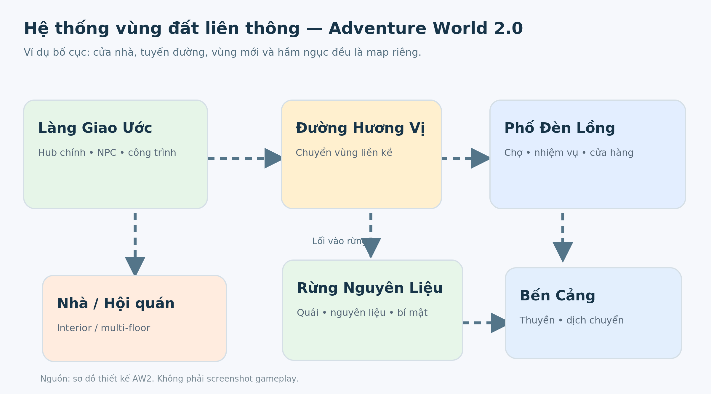

*Hình 2. Mối liên kết logic giữa hub, đường đi, vùng ngoài trời, nhà và dungeon (sơ đồ thiết kế mới).* 

### Cấp tổ chức

- **World** — toàn thế giới Soul of Meal mới; giữ chỉ mục các region.
- **Region** — tập các map cùng chủ đề ẩm thực, thời tiết, quái và câu chuyện.
- **Map** — không gian tương tác hiện tại: làng, tuyến đường, bến cảng, rừng, hang động, v.v.
- **Interior** — một `mapId` đặc biệt bên trong nhà, shop, guild, tầng hầm; dùng cùng engine di chuyển/va chạm.
- **Dungeon** — chuỗi map/phòng có battle, puzzle, loot, event, checkpoint.

### Map demo đầu tiên

| ID đề xuất | Loại | Kết nối |
|---|---|---|
| `village` | Hub ngoài trời | Nhà, hội quán, shop, đường phía Đông |
| `village-home` | Interior | Cửa nhà làng ↔ cửa phía trong |
| `guild-floor-1` | Interior | Cổng hội quán ↔ làng; cầu thang ↔ tầng 2 |
| `guild-floor-2` | Interior | Trở về tầng 1; phòng hoạt động TCG |
| `village-shop` | Interior | Tiệm ăn ↔ làng |
| `route-aroma-01` | Route ngoài trời | Làng ↔ Phố Đèn Lồng; nhánh rừng |
| `lantern-market` | Region map | Đường Hương Vị ↔ chợ; NPC/quest/boss gate |
| `forgotten-kitchen-01` | Dungeon | Từ chợ/hang vào; rương, puzzle, mini-boss |

Chỉ tải map đang đi và tối đa các asset có khả năng cần ngay kế tiếp. Không để màn hình chuyển map phụ thuộc toàn bộ asset game đã tải xong.

### Mockup bản đồ từ trên xuống

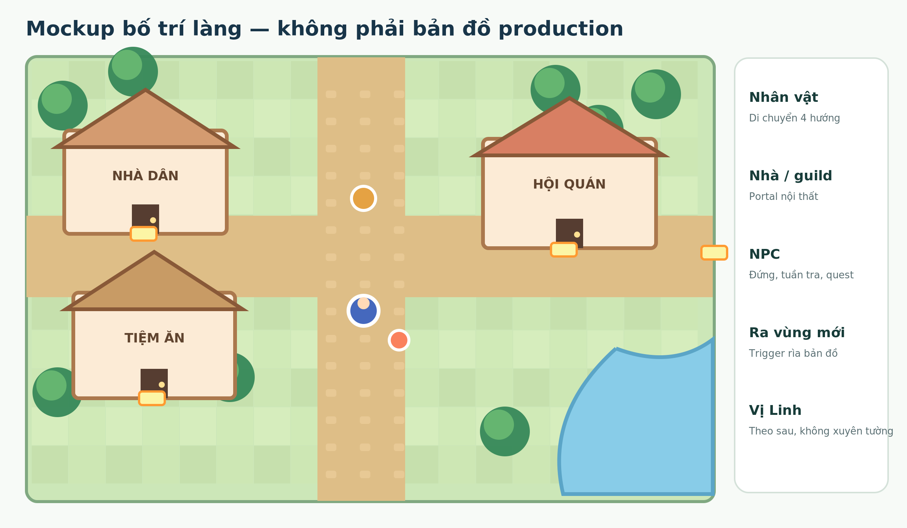

*Hình 3. Mockup dạng block/tile minh họa vị trí nhà, hội quán, tiệm ăn, NPC, nhân vật và cổng chuyển vùng — không phải sản phẩm đồ họa cuối cùng.*

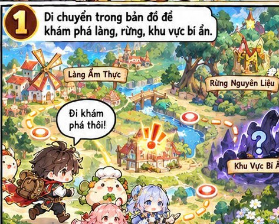

*Hình 4. Ảnh tham khảo từ Chapter 4: làng, khu rừng, đường đi, vùng bí ẩn.*

## 3. Di chuyển tự do, camera và va chạm

### 3.1. Input

- PC: `WASD`/mũi tên; `E`/`Enter` tương tác; `Esc` menu.
- Mobile: joystick ảo + nút tương tác; có thể hỗ trợ chạm đến vị trí hợp lệ nếu kiểm thử thuận tiện.
- Gamepad (giai đoạn sau): analog/DPAD, nút xác nhận/hủy.
- Nhân vật quay mặt theo hướng đi; idle, walk và tương tác dùng pixel atlas.

### 3.2. Movement model

- `tileSize = 32` **là đề xuất cấu hình**, không bắt engine di chuyển từng ô. Logic collision dùng tọa độ world liên tục, tile chỉ là đơn vị biên tập map.
- Controller dùng thời gian delta và tốc độ world-units/sec, tránh phụ thuộc FPS.
- Camera theo player có smoothing có giới hạn; không lộ ngoài mép map và không rung lúc đứng yên.
- Tách collider nhỏ quanh chân khỏi bounds của toàn sprite để dễ đi qua cổng/cửa.
- Object có sort layer theo tọa độ chân, mái/tán cây có foreground che nhân vật phù hợp.

### 3.3. Layers

| Layer | Mục đích |
|---|---|
| Ground | Nền, đường, thảm cỏ, nước nông |
| Terrain | Tường, đá, sông, hàng rào, collider |
| Decoration | Cây, biển hiệu, cửa sổ, đèn đường |
| Foreground | Mái hiên, tán cây, vật thể che nhân vật |
| Actors | Player, Vị Linh, NPC, quái |
| Interaction | Bếp, rương, bảng tin, cây nguyên liệu |
| Trigger | Cửa, cầu thang, ranh map, story cutscene |

**Quy tắc collision:** player/NPC/companion không xuyên vật cản; companion phải có cách thoát kẹt an toàn, không tự xuyên tường trong hành vi thường. Navmesh/grids có thể được tính offline từ collision map, không cần chạy A* từng frame.

## 4. Vào nhà, hội quán và công trình nhiều tầng

**Cơ chế cốt lõi:** ngôi nhà là tòa nhà thật ở overworld; vùng cửa trỏ tới một `mapId` nội thất. Bước vào nhà thay đổi scene, không chỉ hiện popup React.

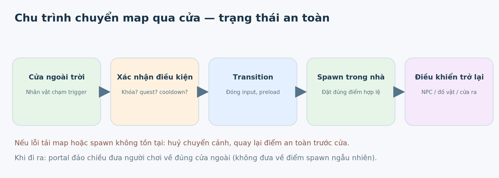

### 4.1. Điều kiện kích hoạt

- **Step portal:** đi qua ngưỡng cửa/cổng sẽ kích hoạt tự động.
- **Interact portal:** phải bấm tương tác, ví dụ thuyền, cửa khóa, cổng thần bí.
- Chỉ cho phép khi người chơi không đang combat, dialog hoặc transition.
- Có `cooldown` ngắn chống vào/ra liên tục do spawn đè lên trigger.
- `requiredFlag`/`requiredItem` quyết định quyền mở; nếu không đạt thì có thông báo nguyên nhân.

### 4.2. Chuyển cảnh an toàn

1. Ghi `sourceMapId`, hướng player, vị trí trước cửa và `portalId`.
2. Tạm ngắt input và bắt đầu fade 150–300 ms **(tham số playtest)**.
3. Preload map nội thất, tileset, NPC cần thiết, giữ map cũ chưa giải phóng.
4. Kiểm tra `spawnId` tồn tại và vị trí spawn không nằm trong collider.
5. Spawn player hướng ra khỏi cửa; spawn companion gần player ở vị trí hợp lệ.
6. Fade in, mở input, bắt đầu event/npc trong nhà.
7. Nếu tải lỗi: quay lại scene gốc, khôi phục input, hiện retry. Không để người chơi ở màn đen.

Khi đi ra, portal đảo chiều dẫn về đúng cửa nguồn, không về trung tâm làng.

### 4.3. Hội quán nhiều tầng

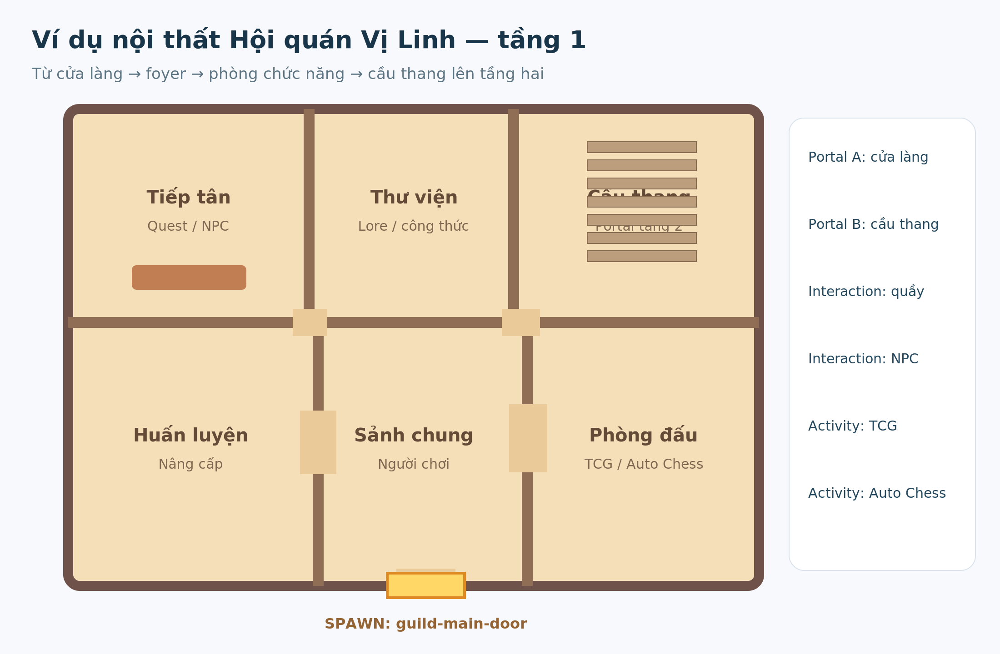

*Hình 5. Floorplan concept gồm quầy NPC, thư viện, cầu thang, huấn luyện và phòng đấu; đường cửa và cầu thang là các portal.*

| Map/Phòng | Gameplay |
|---|---|
| Tầng 1 — Quầy tiếp tân | Nhận nhiệm vụ, thông tin thế giới |
| Tầng 1 — Sảnh huấn luyện | Xem đội hình, tăng level/skill |
| Tầng 2 — Phòng thẻ | Đấu TCG với NPC / event |
| Sân sau — Đấu trường | Auto Chess và thử thách phòng thủ |
| Tầng hầm — Phòng nghiên cứu | Gacha, lịch sử Vị Linh, công thức/hương ấn |

Cửa hàng cũng là interior map. Menu shop chỉ mở khi đứng gần người bán và bấm tương tác.

## 5. NPC: đời sống, hội thoại, nhiệm vụ

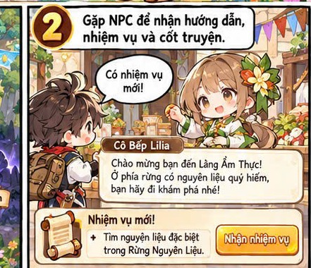

*Hình 6. Tham khảo bố cục NPC/cửa hàng/nhiệm vụ theo mỹ thuật Chapter 4.*

### 5.1. Phân loại NPC

| Loại | Hành vi | Ví dụ |
|---|---|---|
| Static | Đứng tại điểm, quay mặt khi tương tác | Tiếp tân |
| Patrol | Đi theo waypoints, dừng/ngắm cảnh | Dân làng |
| Scheduled | Vị trí/công việc phụ thuộc thời gian game | Thương nhân |
| Quest NPC | Đổi thoại, vị trí, vai trò theo quest flags | Lilia |
| Follower NPC | Theo người chơi trong nhiệm vụ | Người dẫn đường |
| Event NPC | Spawn/despawn theo event/chương | Khách lữ hành |

### 5.2. Hội thoại

- Người chơi cần ở `interactionRadius` và hướng hợp lệ khi cần.
- Khi hội thoại, dừng player và NPC, quay về phía nhau.
- Dialog hiển thị tên, chân dung anime, biểu cảm, lời thoại, lựa chọn và nút tiếp tục/bỏ qua (nếu không phải quyết định bắt buộc).
- Điều kiện choice là dữ liệu định danh, không kiểm tra chuỗi lời thoại.
- NPC có thể mở shop, giao quest, trao thưởng, mở portal, chạy cutscene hoặc chuyển lịch hoạt động.
- Mỗi hành động trao thưởng phải có event ID và được apply idempotent (chống phát lặp).

### 5.3. Lịch trình NPC

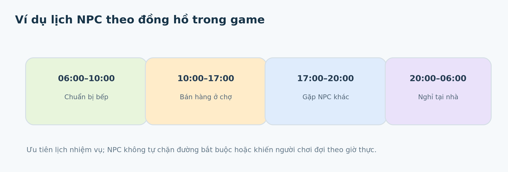

Dùng thời gian **trong game**; không khóa main quest bằng đồng hồ ngoài đời. Một NPC có thể có `schedule[]` với fallback nếu khu vực đang bị story event chiếm dụng. Quest NPC ưu tiên vị trí story; khi event kết thúc mới trở lại lịch thường.

### 5.4. Phản ứng thế giới

Ví dụ quest cứu một thương nhân: trước nhiệm vụ cửa tiệm đóng; sau nhiệm vụ merchant quay lại quầy, bảng hiệu sáng, shop bán món mới, hội thoại đổi. Sự thay đổi phải tồn tại sau reload và trở lại vùng từ map khác.

## 6. Vị Linh đồng hành

- Mặc định hiển thị 1–2 Vị Linh đi theo nhân vật; party chiến đấu vẫn tối đa 5.
- Companion theo lịch sử vị trí hợp lệ của player (breadcrumb/path follow), duy trì khoảng cách; tránh đứng đè portal và chặn cửa.
- Có idle, walk 4 hướng, vui, tò mò, mệt, ngạc nhiên và tương tác đồ ăn. Cấp độ nghệ thuật như nhau cho N/R/SR/SSR/UR.
- Khi đi qua cửa, companion spawn sau player, không tự kích hoạt thêm một chuyển cảnh.
- Khi mất đường hoặc rất xa: warp ở vị trí hợp lệ khuất mắt/hiệu ứng nhẹ, có telemetry/debug flag.
- Companion không tự thay đổi party combat khi đổi ngoại hình hay dialog.

## 7. Chuyển vùng, mở khóa và Fast Travel

| Kiểu | Ví dụ | Trigger |
|---|---|---|
| Adjacent map | Làng → Đường Hương Vị | Bước qua rìa bản đồ |
| Interior | Làng → Nhà dân | Bước qua cửa |
| Vertical | Hội quán tầng 1 → tầng 2 | Cầu thang |
| Travel vehicle | Bến cảng → vùng biển | Tương tác thuyền/NPC |
| Dungeon gate | Rừng → Hầm Bếp | Đủ quest flag/chìa |
| Fast Travel | Hương Trạm đã khám phá | Menu chọn điểm đã mở |

### Kỹ Nghệ Hương Vị (field abilities)

| Rào cản | Cơ chế |
|---|---|
| Dây leo | Mộc mở lối |
| Vực nước | Thủy tạo phương án vượt |
| Băng | Hỏa làm tan |
| Cổng tối | Quang soi sáng |
| Sương ảo | Âm phá ảo ảnh |

**Không khóa tuyến truyện chính sau gacha SSR/UR.** Field abilities bắt buộc phải nhận được qua quest hoặc Vị Linh miễn phí; rarity cao có thể mở shortcut/treasure phụ.

## 8. Quái trên map và chuyển sang đội hình RPG

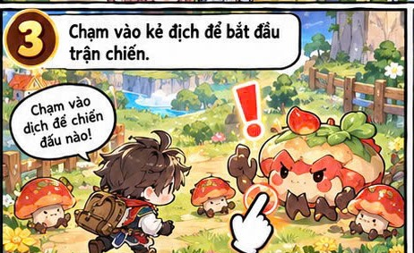

*Hình 7. Quái xuất hiện trực tiếp trên map thay vì chỉ random encounter.*

### Trạng thái AI quái

`IDLE → PATROL → NOTICE → CHASE → ENCOUNTER` và có thể quay lại `PATROL` nếu mất mục tiêu. Elite/boss có thể đứng canh cố định hoặc kích hoạt bằng cutscene/quest.

### Battle bridge

1. Lưu encounter ID, map, safe return position, facing, world flags, đội hình.
2. Đóng world input/render tick không cần thiết; mở RPG arena riêng.
3. Dùng 5 Vị Linh auto normal/skill, thủ công ultimate; giữ tầm đánh, cue projectile/impact và authored VFX.
4. Kết thúc: ghi kết quả/loot một lần, cập nhật quest/monster state.
5. Đưa người chơi về map từ chính encounter, trừ khi cốt truyện yêu cầu dịch chuyển.
6. Mất kết nối/reload giữa battle phải phục hồi từ snapshot hoặc về safe state theo quy tắc rõ ràng; không nhân loot.

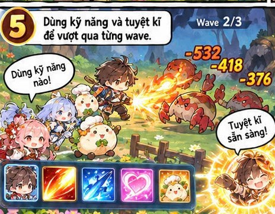

*Hình 8. Tham khảo style chiến đấu từ Chapter 4; battle game mới sử dụng HD sprite và VFX riêng.*

## 9. Khám phá, rương và nấu ăn

Những việc làm trên map cần gắn gameplay và cốt truyện:

- **Treasure:** rương thường, rương khóa, rương bí mật, rương boss. Một rương có stable ID, loot source, lock condition, claim status. Không dựa vào vị trí pixel làm ID.
- **Gathering:** rau, nấm, cá, gia vị, quặng; điểm thu thập có respawn policy rõ ràng.
- **Puzzle:** kéo/đẩy vật, đốt bếp, bật công tắc, phối hợp nguyên tố hoặc giải câu đố công thức.
- **Cooking:** nguyên liệu → công thức → thành phẩm → buff/quest/NPC gift; phiên đầu giới hạn số công thức để kiểm thử dễ.
- **Secret path:** rìa map/địa hình không hiển nhiên, mở bằng story/ability; tránh tạo khu vực chỉ có kho đồ vô nghĩa.

**Vòng nhiệm vụ mẫu:** gặp Lilia → rời làng → phát hiện NPC cần giúp → tìm đường bí mật → lấy nguyên liệu → gặp quái/boss → nấu món → trở về giao nhiệm vụ → shop mở món mới và NPC đổi thoại.

## 10. Kiến trúc kỹ thuật & content contract

### 10.1. Phân lớp

```text
AW2 React shell: menu / journal / quest / inventory / game settings
    └── World Scene Controller
          ├── MapLoader + asset manifests
          ├── Pixi WorldRenderer / layers / camera
          ├── Navigation + collision
          ├── World entities: player, follower, NPC, monster
          ├── Interaction / trigger / portal registry
          ├── Quest / WorldFlag / Reward (deterministic reducer)
          └── BattleBridge → existing RPG engine adapter
    └── Activities: TCG / Auto Chess, in-world portals + quick access
    └── AW2 dev-save store (independent of published legacy save)
```

### 10.2. Content model ví dụ

```ts
interface WorldMapDefinition {
  mapId: string;
  regionId: string;
  displayName: string;
  size: { width: number; height: number; tileSize: number };
  assetPack: string;
  collisionPack: string;
  spawns: Record<string, { x: number; y: number; facing: Direction }>;
  portals: WorldPortal[];
  entities: WorldEntityDefinition[];
  musicId?: string;
}

type Direction = 'up' | 'down' | 'left' | 'right';

interface WorldPortal {
  id: string;
  trigger: { x: number; y: number; width: number; height: number };
  activation: 'step' | 'interact';
  targetMapId: string;
  targetSpawnId: string;
  requiredFlag?: string;
  cooldownMs?: number;
}

interface WorldNpcDefinition {
  id: string;
  mapId: string;
  start: { x: number; y: number; facing: Direction };
  behavior: 'static' | 'patrol' | 'schedule' | 'quest';
  dialogueId: string;
  scheduleId?: string;
  interactionRadius: number;
}
```

### 10.3. Portal sample

```ts
const guildDoor: WorldPortal = {
  id: 'village-to-guild-01',
  trigger: { x: 18, y: 12, width: 2, height: 1 },
  activation: 'step',
  targetMapId: 'guild-floor-1',
  targetSpawnId: 'guild-main-door',
  cooldownMs: 350,
};
```

### 10.4. World save — chỉ dành cho game mới

```ts
interface Aw2WorldProgress {
  version: 1;
  mapId: string;
  position: { x: number; y: number; facing: Direction };
  discoveredMaps: string[];
  worldFlags: Record<string, boolean>;
  openedChests: string[];
  questStates: Record<string, 'locked' | 'active' | 'complete'>;
  defeatedBosses: string[];
  activeEncounterId?: string;
}
```

**Alpha:** save AW2 riêng, có nút xác nhận reset để thay đổi dữ liệu dev; tuyệt đối không xóa `foodchest.tcg.v1` hoặc dữ liệu ổn định của game cũ theo mặc định. **Sau release:** bắt buộc versioned migrations, restore và compatibility tests trước patch.

### 10.5. Cơ chế engine

- Deterministic reducer quản lý quest, event, claim, battle handback, không cho renderer tự cộng thưởng.
- AssetRegistry sử dụng stable character/monster ID; pixel world và HD battle là variant, tránh nhân đôi nhân vật.
- Data-driven maps, portals, interactables, quest graphs; typecheck và runtime schema validation.
- Preload map đích, giữ bản cũ trong lúc transition; sau successful swap mới unload.
- Không tạo timer theo từng Vị Linh/NPC khi có thể dùng một world clock/tick và interpolation.
- Không claim đạt 60 FPS nếu chưa đo. Mục tiêu desktop 60 FPS, low-power 30 FPS; phụ thuộc kiểm thử thật.

## 11. Tích hợp TCG, Auto Chess và gacha

- **TCG:** phòng đấu trong hội quán với NPC và event. `ModePortal` mở đúng route/activity; đóng quay lại portal spawn, vẫn có truy cập nhanh trên HUD.
- **Auto Chess:** sân đấu/đại hội Vị Linh, không yêu cầu thắng để tiếp tục main story. Có quick entry và không reset world position.
- **Gacha:** năm rarity `N → R → SR → SSR → UR`, được phát triển riêng cho AW2. Các mức drop rate/pity chưa được duyệt là số chính thức. Không gộp cứng dữ liệu gacha legacy 4-tier. Nhân vật N/R/SR vẫn phải đủ khả năng vượt cốt truyện.
- **Progress:** chia sẻ nhận diện nhân vật và các cờ truyện liên quan, nhưng balance TCG/Auto Chess độc lập với stat RPG.

## 12. Vertical Slice và PR Roadmap

**Bản demo mục tiêu:** 3 map ngoài trời (`village`, `route-aroma-01`, `lantern-market`), ít nhất 4 interior (nhà, shop, guild tầng 1 và tầng 2), 1 dungeon từ 3 phòng trở lên, 8–12 NPC, hai Vị Linh đi theo, một trận thường, một trận boss và vòng trả quest hoàn chỉnh. 12 nhân vật là mục tiêu production toàn bộ giai đoạn đầu; không bắt buộc tất cả phải xuất hiện trong 15 phút demo đầu tiên.

| PR | Phạm vi | Điều kiện nghiệm thu |
|---|---|---|
| AW2-W01 | Map data/schema + save namespace | Khởi tạo, validate, reset AW2 riêng; legacy không đổi |
| AW2-W02 | Tile layers + camera + collision/input | Không xuyên vật cản; touch/keyboard nhất quán |
| AW2-W03 | Portal transitions + house/guild interiors | Đi hai chiều, save/reload, fallback lỗi |
| AW2-W04 | NPC + dialogue + schedules | NPC tương tác được, quest state không nhân đôi |
| AW2-W05 | Companion + world monsters | Follower không kẹt, AI quái chuyển trạng thái đúng |
| AW2-W06 | Battle bridge + rewards | Đội 5 auto/manual ultimate, thoát về đúng map |
| AW2-W07 | Dungeon + chest + cooking | Puzzle, boss, loot idempotent |
| AW2-W08 | TCG/Chess activity portals | In-world/direct access, return-to-world đúng |
| AW2-W09 | Art/VFX and perf QA | Đúng manifest/model/FX, tải theo map, quyền asset |
| AW2-W10 | Vertical Slice full regression | Luồng làng → dungeon → boss → quest → trở về đạt |

## 13. Test cases và Definition of Done

| ID | Test | Gate |
|---|---|---|
| MAP-01 | Player đi quanh nhà/tường/cây; không xuyên | W02 |
| MAP-02 | Camera follow và biên map 16:9/portrait | W02 |
| PORTAL-01 | Vào/ra nhà đúng cửa, không loop portal | W03 |
| PORTAL-02 | Thiếu spawn/asset: rollback, không màn đen | W03 |
| PORTAL-03 | Cầu thang lên/xuống giữ đúng spawn | W03 |
| NPC-01 | Hội thoại mở đúng khoảng cách/hướng, không double | W04 |
| NPC-02 | NPC đổi lịch và quest flags bền vững qua reload | W04 |
| FOLLOW-01 | 2 Vị Linh theo, tránh vật cản, không kích portal kép | W05 |
| ENEMY-01 | Patrol/notice/chase/return/encounter đúng | W05 |
| BATTLE-01 | Save battle snapshot, attack/contact/VFX/ultimate chính xác | W06 |
| BATTLE-02 | Kết thúc về đúng map, reward 1 lần khi reload | W06 |
| CHEST-01 | Nhặt rương một lần, chống double-click/reload | W07 |
| MODE-01 | Vào TCG/Chess trong guild và quick access, return đúng | W08 |
| SAVE-01 | Reset AW2 alpha không xóa legacy save | W01 |
| PERF-01 | FPS, bộ nhớ, load, offline kiểm tra trên thiết bị | W09/W10 |
| RIGHTS-01 | Asset có nguồn/cấp phép hợp lệ | W09/W10 |

**Quy định QA agent:** mỗi thay đổi chọn test bị tác động; ghi command, environment, commit và PASS/FAIL/STALE. Không cần full regression mọi lần phát triển nhỏ; nhưng full suite bắt buộc trước milestone/merge có ảnh hưởng nền hoặc release. Không đánh dấu test PASS dựa vào kiểm thử cũ bị thay đổi dependency.

**Done Definition:** người chơi thao tác được từ làng → vào hội quán → ra cửa → theo đường qua vùng → nói chuyện NPC → nhặt đồ → gặp quái → chiến đấu → thắng dungeon boss → giao quest → quay về; mọi thay đổi được lưu và không ảnh hưởng game cũ.

## 14. Phân việc cho bảy agent

| Agent | Input | Output |
|---|---|---|
| `story-agent` | World/region design, lore | Map story, NPC scripts, quest consequences |
| `character-agent` | 12-character canon, enemy ecology | NPC identity, quái/elite/boss, world/battle art IDs |
| `mechanic-agent` | World schemas, quest contracts | Movement, triggers, combat bridge, rewards, dungeon |
| `animation-agent` | Map/character art specification | Pixel atlas 4 hướng, HD variants, interaction/VFX states |
| `tester-agent` | Diff + impacts + build | Selective QA, traceable test ledger, regression gates |
| `scretary-agent` | PR/decisions/agent output | STATUS, HANDOFF, CHANGELOG, blockers và next steps |
| `ba-agent` | User requirements and constraints | User stories, AC, dependencies, priority, risk |

**Tài liệu bổ sung:** `AGENTS.md`, `docs/aw2/DECISIONS.md`, `CANON.md`, `BACKLOG.md`, `TEST_LEDGER.md` trên nhánh `game/adventure-world-2`. Bất kỳ việc triển khai nào cũng phải kiểm tra trạng thái thực tế của nhánh, không giả định bản đặc tả đã được code.

---

### Ghi chú hình ảnh
- `chapter4_*.jpg`: cắt từ **hình Chapter 4 người dùng cung cấp**; chỉ minh họa định hướng.
- `world_regions.png`, `village_mockup.png`, `guild_floorplan.png`, `portal_sequence.png`, `npc_schedule.png`: sơ đồ tự xây dựng cho tài liệu này, chưa phải assets chạy trong game.
- Bộ ZIP kèm thư mục `assets/` để hình hiển thị offline trong Markdown viewer (VS Code Preview/Obsidian/GitHub sau khi commit cả folder).
- Bản `.md` lẻ chỉ hiển thị hình khi đặt cùng thư mục `assets/` tương ứng.

---


## 15. Quest HUD và Single-Screen UI

> **ĐÃ CHỐT VỀ TRẢI NGHIỆM:** AW2 là trò chơi trong một vùng hiển thị cố định (*single viewport*), không phải website có nhiều section cuộn dọc. Màn hình bản đồ là bề mặt nền; các tính năng mở qua menu cố định, submenu, modal hoặc game scene duy nhất. Lấy cảm hứng cấu trúc menu phân khu chức năng từ *Azur Lane* và *Princess Connect! Re:Dive*, không sao chép UI/asset nhận diện từ các game đó.

### 15.1. Wireframe desktop và mobile

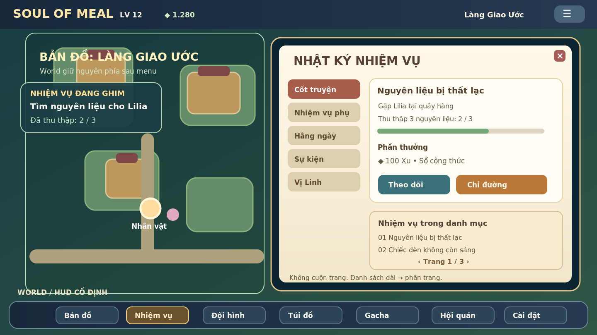

*Hình 15A — Wireframe do dự án tự dựng để mô tả: map nền + quest tracker + dock + bảng quest nổi. Đây không phải screenshot game đã code.*

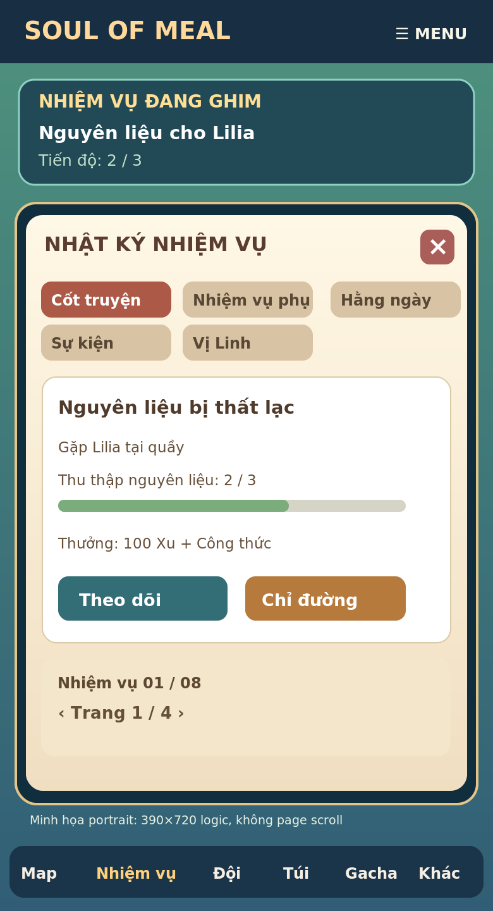

*Hình 15B — Thiết kế thay đổi bố cục theo thiết bị, không yêu cầu cuộn trang. Có thể ưu tiên landscape trên mobile; portrait dùng overlay toàn chiều rộng. Đây là sơ đồ UX, không phải mockup mỹ thuật cuối.*

### 15.2. Ba lớp giao diện và quy tắc điều hướng

| Layer | Thành phần | Khi nào xuất hiện | Luật |
|---|---|---|---|
| World | Map, player, NPC, quái, companion | Mặc định | Vẽ gameplay; input world bị khóa khi panel blocking |
| HUD | Mini-map, một nhiệm vụ ghim, prompt tương tác, tài nguyên nhỏ, dock | Khi khám phá | Không che các đối tượng chiến đấu / tương tác chính; ẩn linh hoạt khi cinematic |
| Overlay | Quest Journal, team, inventory, cooking, shop, gacha, settings, NPC dialogue | Khi người chơi mở | Chỉ **một panel blocking** hoạt động; Esc / Back đóng để quay lại world trước đó |

Các hoạt động TCG/Auto Chess có thể chuyển sang **scene cùng khung game** (không tạo document scroll) do yêu cầu hiển thị bàn chơi; vào qua công trình hoặc nút truy cập nhanh, quay lại bản đồ giữ nguyên mapId/position/world context. Không buộc mọi hoạt động nằm trong popup bé, vì sẽ ảnh hưởng gameplay và độ dễ đọc.

**Bố cục landscape/desktop:** header trên (tài nguyên vừa đủ), quest HUD ngắn tại góc, dock dưới, Quest Journal dạng panel trung tâm/phải (chiếm khoảng 55–70% khung), map nền giảm sáng nhẹ.

**Bố cục mobile:** bottom dock tối đa 4–5 hành động ưu tiên và nút Thêm; quest tracker thu gọn. Quest Journal là full-screen in-game panel hoặc panel gần toàn màn hình. Hỗ trợ safe area, notch, tỉ lệ khác nhau, landscape và portrait. Nút tương tác có vùng chạm mục tiêu tối thiểu 44×44 CSS px nếu đủ không gian.

**Không cuộn trang**: root/shell có chiều cao đúng viewport; không scroll window/body. Danh sách dài dùng tab và phân trang bằng nút Trước/Sau (mỗi trang 2–5 dòng tùy không gian), mô tả dài chia nhiều màn văn bản có nút Tiếp, không giảm font xuống mức khó đọc. Chỉ xem xét internal scroll cho một số nội dung ngoài gameplay như Legal/Credits sau này; đây là ngoại lệ có chủ đích, không phải scroll cho core quest UX.

### 15.3. Quest submenu trong cùng màn hình

| Khu | Thành phần | Hành vi |
|---|---|---|
| Truy cập | Nút **Nhiệm vụ** trên dock, phím tắt `J` desktop | Mở/đóng bảng, không đổi route web |
| Nhóm | Cốt truyện / Phụ / Hằng ngày / Sự kiện / Vị Linh | Chỉ nhóm có dữ liệu mới cần hiển thị, có badge khi nhận thưởng được |
| Danh sách | Tên, cấp gợi ý, vị trí, tiến độ, trạng thái | Chọn bằng click/keyboard/gamepad; không tự nhận thưởng |
| Chi tiết | Tóm tắt, objective, NPC liên quan, tiến độ, phần thưởng | Trên cùng panel, không mở tab web |
| Theo dõi | Ghim tối đa **3 nhiệm vụ**, trong đó 1 ưu tiên | Tracker luôn chỉ hiện tiêu đề + objective hiện tại |
| Chỉ đường | Đặt marker và gợi ý route đến NPC/cổng hoặc map liên quan | Không dịch chuyển xuyên các vùng chưa mở; nếu vị trí chưa biết thì hiển thị gợi ý hợp lý |
| Nhận thưởng | Hiện chỉ khi quest đã hoàn thành và đủ điều kiện | Atomic/idempotent grant; chống double click, reload, import replay |
| Trở về | `Esc`, phím Back, đóng X, nút màn hình cảm ứng | Trả world focus và vị trí map, không mất input hoặc quest |

Các nhóm chưa phát triển trong Vertical Slice (Daily/Event/Character) có thể ẩn để giao diện gọn; không dựng nút giả không có chức năng.

### 15.4. Luồng một nhiệm vụ từ NPC đến nhận thưởng

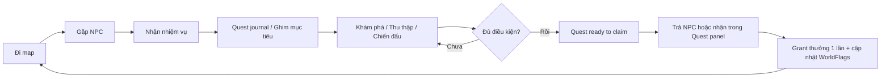

**Điều kiện tương tác:** Main Quest cốt truyện có thể yêu cầu trả NPC, nhưng vẫn hiển thị theo dõi và chỉ đường ở Quest panel. Các nhiệm vụ thưởng tự động có thể hiện nút Nhận sau khi hoàn thành. Trạng thái quest là nguồn sự thật chung của NPC, tracker, minimap và panel; không duy trì bốn bản sao trạng thái.

```ts
type QuestCategory = "main" | "side" | "daily" | "event" | "character";
type QuestStatus =
  | "locked" | "available" | "active"
  | "ready_to_claim" | "claimed";

interface QuestJournalState {
  selectedCategory: QuestCategory;
  selectedQuestId: string | null;
  trackedQuestIds: string[]; // max 3; immutable IDs
  pageByCategory: Partial<Record<QuestCategory, number>>;
}

type GamePanel =
  | "none" | "quest" | "party" | "inventory"
  | "cooking" | "npc-dialogue" | "gacha" | "settings";
```

Ví dụ model UI tách biệt trạng thái content/save: `GamePanel` chỉ là local navigation, `QuestStatus` là persistent progression; mở/đóng panel không ghi liên tục vào save. `trackedQuestIds` có thể lưu nếu muốn theo dõi qua các phiên.

### 15.5. Điều khiển overlay, không đụng world navigation

1. Khi Quest panel mở: ngưng điều khiển player/joystick/keyboard world; combat clock và lịch world áp dụng quy tắc pause đã thống nhất (single player offline: **ưu tiên pause world**).
2. Overlay có focus trap, focus vào heading hoặc tab đầu và trả focus về nút mở khi đóng; hỗ trợ gamepad/keyboard.
3. `Esc`/Back đóng panel cấp cao nhất; không vô tình đóng cả game, không reset selected objective.
4. Nếu xuất hiện tương tác cấp cao hơn (xác nhận nhận thưởng, cutscene), chỉ hiển thị một active dialog, không cho menu xuyên lớp và click-through.
5. Đổi map hoặc vào combat: đóng overlay có kiểm soát hoặc giữ pending state theo quy tắc rõ; không render quest popup trên battle screen.
6. Localized Vietnamese labels không bị cắt ở 320px; dùng pagination và responsive layout thay vì scale cả UI thành nhỏ không đọc được.

### 15.6. Kiến trúc UI khuyến nghị

```text
<GameShell fixedViewport>
  <WorldCanvas />
  <HUD>
    <TopResourceStrip />
    <PinnedQuestTracker />
    <InteractionPrompt />
    <BottomNavigation />
  </HUD>
  <OverlayManager activePanel={activePanel}>
    <QuestJournal categories/pages/details/>
    <PartyPanel />
    <InventoryPanel />
    <NPCDialogue />
  </OverlayManager>
</GameShell>
```

Tách `uiNavigationStore` (activePanel/returnFocus/category/page) khỏi `worldStore` (position/mapId/worldPause) và `questStore` (quest engine/events/rewards). Renderer map không unmount khi mở Quest Journal; chỉ lock movement và giảm animation không cần thiết. Không tạo logic quest trong các component React.

### 15.7. Test bổ sung bắt buộc

| ID | Kịch bản | Expected |
|---|---|---|
| UI-QUEST-01 | 320×568, 390×844 portrait và 844×390, 1280×720 landscape | Không có document scroll, không overflow/cut nút |
| UI-QUEST-02 | Quest Journal có 30–100 nhiệm vụ | Tab/phan trang đầy đủ, focus và keyboard hoạt động; không cần cuộn trang |
| UI-QUEST-03 | Mở panel khi player đi, sau đó đóng | Player không trôi, quay về đúng map và vị trí |
| UI-QUEST-04 | Quest thay đổi khi game đang ở NPC/map | HUD, Journal và NPC đồng bộ qua cùng quest state |
| UI-QUEST-05 | Chỉ đường tới khu vực chưa mở | Không teleport/không đánh dấu địa điểm ẩn bất hợp lý |
| UI-QUEST-06 | Nhấn nhận thưởng nhiều lần, reload giữa grant | Thưởng đúng một lần, không mất/dup |
| UI-QUEST-07 | Chạm nền map khi panel mở | Không đi/chạm NPC/quái xuyên overlay |
| UI-QUEST-08 | Quest có tên/miêu tả dài và chữ lớn | Không tràn màn, nút chạm còn dùng được; pagination/dialogue page |
| UI-QUEST-09 | Mở đội/túi/gacha từ menu và quay lại | Một panel tại một thời điểm, trạng thái gameplay được giữ |
| UI-QUEST-10 | Chuyển qua TCG/Auto Chess, thoát về world | Return context chính xác, không quay nhầm spawn và không phá save |

Tester-agent đánh dấu các case là **NOT_RUN** trước triển khai, chỉ PASS khi có commit/command/thiết bị và evidence. BA sở hữu acceptance, mechanic sở hữu quest engine, animation sở hữu UI transitions/art, story sở hữu quest copy/NPC, scretary-agent ghi quyết định và trạng thái kiểm thử.
